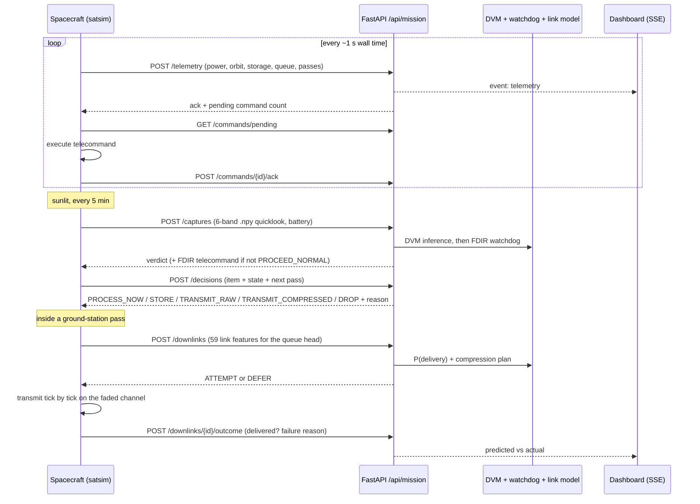

# satsim: simulated CubeSat for Satellite Brain

A standalone spacecraft that flies against the FastAPI ground segment over HTTP only. It never imports
backend code. Every image it takes goes through the real DVM model and FDIR watchdog, every product
gets a decision from the decision policy, and every downlink is planned by the link-delivery model and
then scored against what "really" happened on a simulated channel. The dashboard's **Mission ops**
view shows all of it live.

## Run it

```bash
scripts/dev.sh                          # backend :8000 + dashboard :3000 + simulator (nominal_day, x60)
scripts/dev.sh novel_event 120          # another scenario, faster
```

Or start the pieces separately (backend and frontend as in the main README), then:

```bash
cd simulator
../backend/.venv/bin/python -m satsim --api http://localhost:8000 --scenario swir_detector_failure --speed 60
```

| Option | Default | |
|---|---|---|
| `--scenario` | `nominal_day` | see below |
| `--speed` | `60` | simulated seconds per wall second; `0` = as fast as possible |
| `--duration` | until Ctrl-C | simulated hours |
| `--start` | now | ISO 8601 UTC start time |
| `--seed` | `7` | same seed + start, same flight |
| `--sat-id` | `ORBITAL-01` | the dashboard follows `ORBITAL-01` |

The simulator only needs `numpy` and `httpx` (`requirements.txt`); the backend's venv already has both.

## The loop



If the API is unreachable the spacecraft keeps flying. It stores products while storage allows, attempts
downlinks only with a clear capacity margin, buffers telemetry and command acks, and replays them in
order once the link is back. It also backs off exponentially between retries, and enters SAFE mode
on its own below 20 % battery.

## What is simulated

| Subsystem | Model |
|---|---|
| Orbit | 520 km sun-synchronous circular orbit (10:30 LTAN), two-body, spherical Earth |
| Eclipse | low-precision sun ephemeris, cylindrical shadow (~37 % of each orbit) |
| Ground stations | 6 illustrative stations on the radio dataset's archetypes (GS01-GS10); passes above each elevation mask |
| Power | solar input in sunlight, base/payload/heater/radio/processing loads, 80 Wh battery |
| Payload | 6-band scenes mixed from material spectra; faults: dead band, saturation, NaN bit flip |
| Link | FSPL, rain/cloud/gas attenuation, scintillation, kTB noise, interference, adaptive DVB-S2-like MODCOD; all 59 model features, with formulas checked against the dataset |
| Channel "truth" | forecast plus unforecast fade and scintillation per step; selective-repeat ARQ; outage, retry-budget and contact-time failures |
| Onboard executive | FDIR and operator telecommands, compress-before-radio, onboard processing, periodic re-review of stored products |

## Scenarios

| Scenario | What it exercises |
|---|---|
| `nominal_day` | normal imaging and passes; uncertain verdicts become thumbnails and stored products |
| `eclipse_low_battery` | degraded panels and a stuck heater: R3 battery reserve, then autonomous SAFE mode |
| `swir_detector_failure` | B12 stuck at 15 min: `SENSOR_DEAD_CHANNEL` → `SWITCH_TO_4BAND_VNIR`; send `RESTORE_6BAND` to recover |
| `radiation_bit_flips` | NaN pixels and saturated bands: `RADIATION_BIT_FLIP` / `SENSOR_NOISE_SATURATION` → raw thumbnails |
| `novel_event` | wildfire scenes: `ENVIRONMENTAL_NOVELTY` alerts, protected and sent first |
| `bad_weather_pass` | rain and heavy rain at every pass: model deferrals and real link outages |
| `storage_pressure` | small disk, fast captures: R6/R4 drops, onboard processing, compression |

## Ground-segment API (`/api/mission`)

| Endpoint | |
|---|---|
| `POST /telemetry` | housekeeping frame; returns the pending-command count |
| `POST /captures` | multipart `.npy` patch → DVM + watchdog; raises FDIR telecommands |
| `POST /decisions` | decision policy for one product |
| `POST /energy/predict`, `POST /compression/plan` | the two fallback predictors on their own |
| `POST /downlinks`, `POST /downlinks/{id}/outcome` | link-model plan, then the real outcome |
| `GET /commands/pending`, `POST /commands/{id}/ack` | uplink and acknowledgement |
| `GET/POST /commands` | history; operator commands |
| `GET /state`, `GET /stream` | dashboard snapshot and Server-Sent Events (`?after=<id>&follow=false` replays) |

## Honest caveats

- **Energy and compression predictors are fallbacks.** The README's Random Forest and XGBoost models are
  not in this repo, so `app/services/energy.py` (E = P × T per phase) and `app/services/compression.py`
  (ratio = size / window capacity) stand in behind the same interface. Every response says so.
- **The DVM is uncertain on synthetic scenes.** About 40 % of ordinary captures exceed the 0.82 entropy limit
  whatever the texture, so the watchdog raises `AI_UNCERTAINTY_SPIKE` often. The payload is dimmed to
  0.3× nominal reflectance, where the model is most confident on land, and textured so smooth scenes don't
  trip the dead-detector check. Wildfire scenes (emitted SWIR) are left bright and trip novelty about
  35 % of the time.
- **Urgency labels are unknown.** The traced model emits 4 urgency probabilities, while the training notebook
  defines 3 classes (NORMAL, FIRE, FLOOD). The policy only protects a confident last-class call (≥ 0.6),
  which in practice almost never fires; alerts come from the watchdog's novelty check.
- Everything is synthetic, including the link model's training data. Results are illustrative, not flight-validated.

## Tests

```bash
cd simulator && ../backend/.venv/bin/python -m pytest -q
```

Unit tests cover the orbit, link contract (the feature set equals the model's metadata), payload faults,
outage buffering, every scenario and the executive. `test_e2e.py` flies the spacecraft against the real
FastAPI app in-process for 6 simulated hours, with the real models, and checks that telemetry, verdicts,
decisions, downlink outcomes and acknowledged commands all land.
